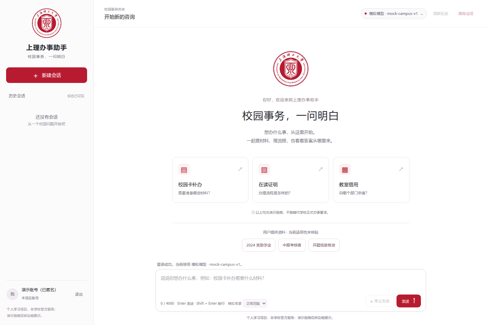
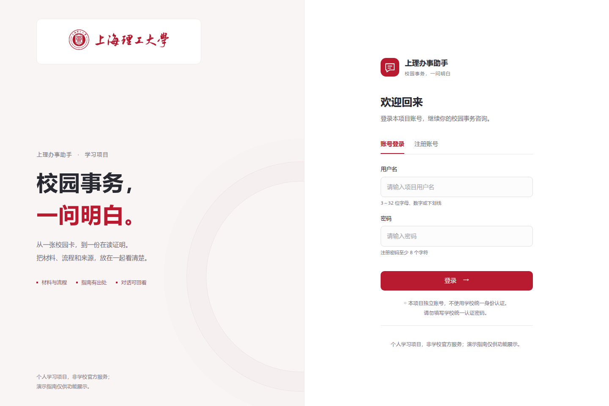
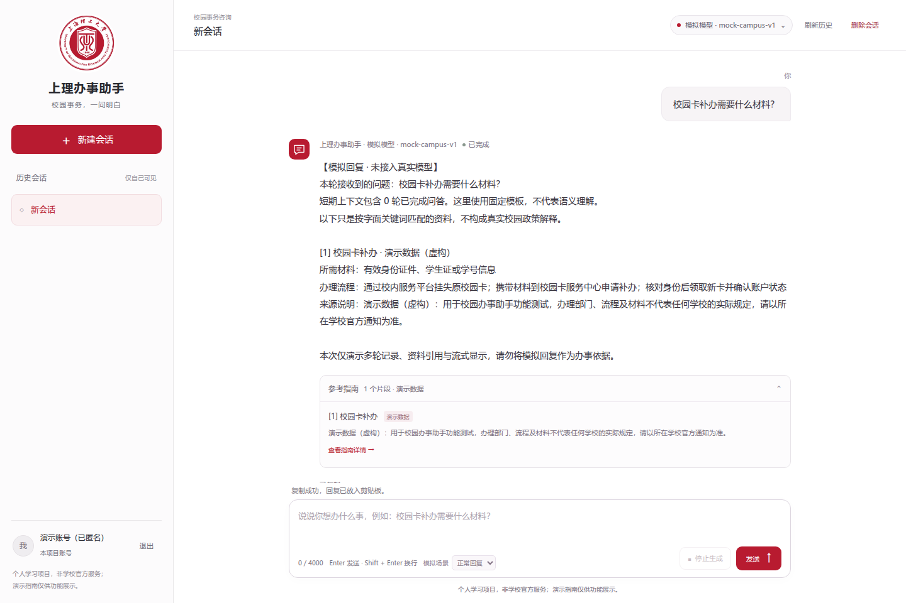
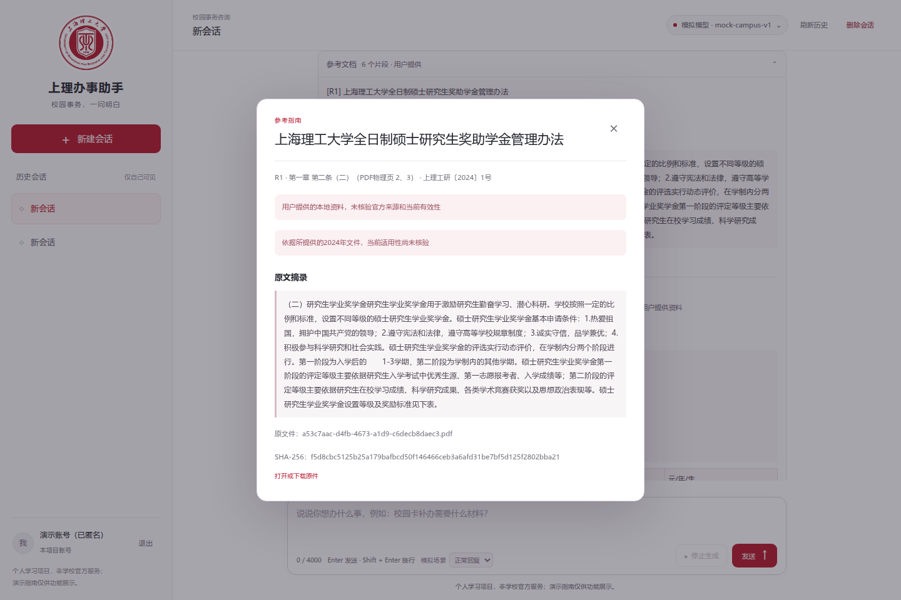
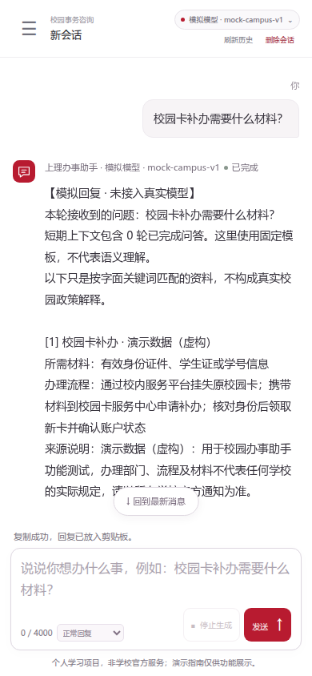
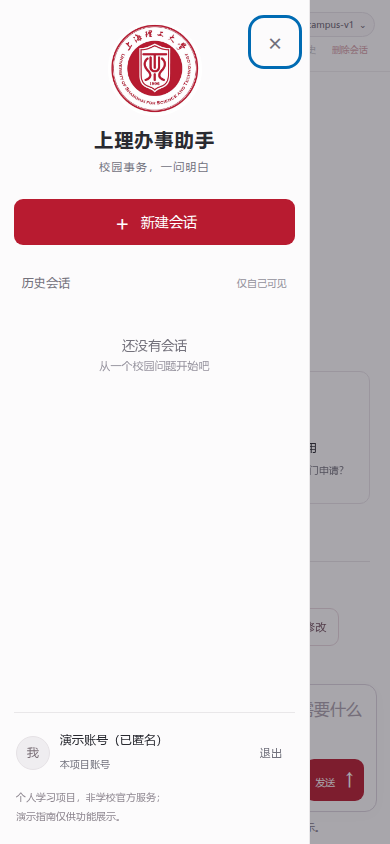
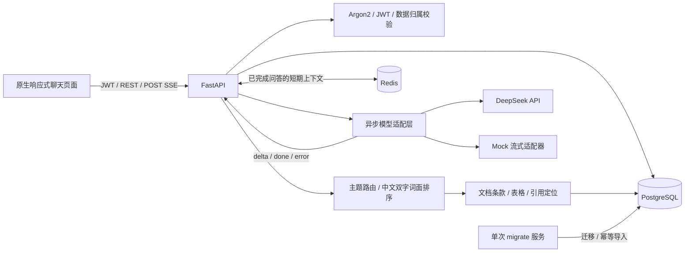

# 上理办事助手 · USST Campus Assistant

面向校园事务咨询的个人学习项目：支持多轮聊天、流式回复、资料检索、可展开引用及个人会话历史。

**Python / FastAPI · PostgreSQL · Redis · DeepSeek · SSE · Docker Compose**

> 个人学习项目，非上海理工大学官方服务。内置8条办事指南为虚构演示数据；提供的2024年文件未核验当前适用性。项目账号不接入学校统一身份认证，请勿输入学校账号密码。

## 项目预览



<details>
<summary>查看登录、聊天、文档引用及手机端截图</summary>





 

截图使用明确标注的 mock 模式与匿名显示名，用于展示产品交互，不作为真实模型回答质量证据。
</details>

## 能做什么

- **独立账号与个人历史**：Argon2密码哈希、JWT认证，按用户隔离会话和消息，支持分页与会话删除。
- **异步流式聊天**：DeepSeek适配器与免费mock模式；浏览器使用带Bearer头的POST fetch读取SSE，支持停止、超时和失败状态。
- **校园资料检索与引用**：3份文件按条款、栏目及表格分块；保存版本、哈希和定位，回答只展示实际引用的合法编号，原件入口需要登录。
- **有边界的分析**：一般交流与学习规划可由模型分析，具体金额、资格和期限优先依据资料，区分原文与建议。
- **可恢复的上下文**：PostgreSQL保存完整历史；Redis只缓存最近已完成的问答，过期或不可用时回源，失败/取消的回答不进入正常上下文。
- **可复现部署**：Compose管理应用、单次初始化、PostgreSQL和Redis；增量迁移与幂等导入，非root应用镜像。

## 快速开始

适用：Linux / WSL 2 的 Bash，已安装 **Python 3.12**、Git及支持启动依赖条件的Docker Compose。Windows用户先启动Docker Desktop并启用WSL集成。依赖和基础镜像首次下载需要网络。

```bash
git clone https://github.com/SunHaijian-creator/usst-campus-assistan.git usst-campus-assistant
cd usst-campus-assistant

# 纯标准库初始化，不安装Python依赖；生成随机数据库密码与JWT密钥。
# 已有 .env 会完整保留。
python3 -m scripts.setup_env

docker compose up -d --build
docker compose ps --all
curl --fail http://127.0.0.1:8000/ready
```

打开 **http://127.0.0.1:8000/**，注册本项目账号并登录。接口文档在 **/docs**。

预期：`app`、`postgres`、`redis`健康，`migrate`执行完成退出码0。迁移到`0005_reference_documents`，初始化导入8条演示指南、3份资料和30片段，其中29片段允许检索。重复启动不会重复导入，也不重置已有账号和历史。

默认 **mock** 不产生模型API费用，可演示登录、检索、引用、流式和历史；它是固定模板，不具备真实语义推理能力。`/health`只检查进程响应，`/ready`要求数据库可用，Redis不可用时标记降级。

### 启用真实DeepSeek

只在本机 `.env` 中填写以下字段，保留已有数据库密码和JWT密钥：

```dotenv
MODEL_PROVIDER=deepseek
MODEL_NAME=deepseek-flash
MODEL_BASE_URL=https://api.deepseek.com
MODEL_API_KEY=your_deepseek_api_key_here
MODEL_MAX_TOKENS=1024
MODEL_TIMEOUT_SECONDS=30
```

```bash
docker compose up -d --force-recreate app
```

密钥仅由后端读取，不能写入前端或提交Git。真实请求按供应商额度计费；适配器关闭自动重试，使用非思考模式。回到mock时设置`MODEL_PROVIDER=mock`并重建app容器。配置说明见[模型接入](docs/deepseek.md)。

### 日常启停

```bash
docker compose stop          # 停止，保留数据卷
docker compose up -d         # 再次启动
docker compose logs --tail=80 app migrate
```

不要删除数据卷。`APP_PORT`、`POSTGRES_PORT`、`REDIS_PORT`可在`.env`调整；所有映射端口默认仅绑定127.0.0.1。容器之间使用服务名`postgres`/`redis`，不是宿主机地址。

## 架构与数据流



1. 校验登录、会话归属和并发生成状态，写入用户消息及生成记录。
2. 读取已完成历史与相关资料；无关资料不强行作为引用。
3. 将上游流转换为`meta / delta / done / error`，客户端停止时关闭上游并保存取消状态。
4. 正常完成后保存助手消息及合法引用，更新短期上下文。模型等待期间不持有长数据库事务。

**技术边界**：当前是面向3份小文档的主题路由、中文双字词面评分和规则联检，没有向量数据库、embedding、BM25或自主工具调用。可称为检索增强问答应用，不宣称为多工具自主Agent。编号校验保证引用来自候选片段，不等于自动证明每句话都被原文支持。

## 资料与回答边界

| 资料 | 使用方式 |
| --- | --- |
| 全日制硕士研究生奖助学金管理办法（2024） | 保留适用对象、例外、跨页条款和表格对应关系，强制提示当前适用性未核验 |
| 研究生中期考核表 | 依据栏目与注释回答，空白字段不能推断最低学分或截止日期 |
| 学位论文开题及信息提交流程 | 仅检索4条正文注释，未核对箭头的流程图片段禁止用于生成步骤 |

原件与提取记录见[data/references/usst](data/references/usst)，导入与定位机制见[资料接入说明](docs/references.md)。文件作为数据处理，不执行其中的宏、链接或指令。提供的文件仅用于个人学习展示，不代表学校当前政策。

## 开发与测试

```bash
python3 -m venv .venv
source .venv/bin/activate
python -m pip install -r requirements-dev.txt
python -m scripts.setup_env
docker compose up -d postgres redis
python -m alembic upgrade head
python -m scripts.import_demo_guides
python -m scripts.import_usst_references
python -m pytest -q tests
```

测试需要可连接的PostgreSQL与Redis，数据库账号需要`CREATEDB`权限。测试为每次运行创建随机临时库，使用随机JWT密钥和明确的Redis测试键，退出后清理；不清空开发库或Redis。上游调用使用模拟响应，不自动消耗真实额度。

本地热重载：停止Compose中的app后执行`python -m uvicorn app.main:app --host 127.0.0.1 --port 8000 --reload`。已有app占用8000端口时不要同时启动另一个后端。

### 验证记录

| 范围 | 已有验收证据 |
| --- | --- |
| 离线/集成回归 | 原开发环境记录217项通过；包括认证隔离、事务、缓存、SSE、引用、初始化与就绪检查 |
| 浏览器交互 | 原验收覆盖桌面1440×960及手机390×844；截图位于docs/screenshots |
| Compose | 原部署记录app健康、单次迁移成功、同镜像隔离测试及重启历史保留 |
| 真实DeepSeek | 3次请求：连接、演示指南流式回答、多轮追问，记录见[真实调用账本](docs/deepseek-live-result.json) |
| 尚未真实验收 | 新回答策略的语义质量、新文档引用、真实上游停止，不能用离线mock结果代替 |

GitHub Actions已在独立PostgreSQL和Redis环境中完成217项测试：[查看运行结果](https://github.com/SunHaijian-creator/usst-campus-assistan/actions/runs/39807421792)。自动测试使用模拟上游，不产生模型API费用。

## 技术文档

- [回答策略](docs/answer-policy.md)
- [SSE与会话](docs/chat.md)
- [前端实现](docs/frontend.md)
- [资料接入](docs/references.md)
- [模型接入](docs/deepseek.md)
- [已知限制](docs/limitations.md)

## 素材与使用说明

校徽、校名、标准色及学校文件的权利归相应权利方；公开获取不等于可以任意授权再使用。来源记录见[素材说明](app/web/assets/SOURCES.md)与[第三方说明](THIRD_PARTY_NOTICES.md)。部署或复用时请自行核对相应用途。本仓库不表示学校背书。
